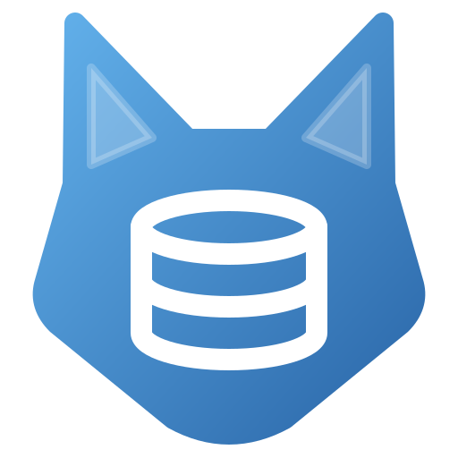
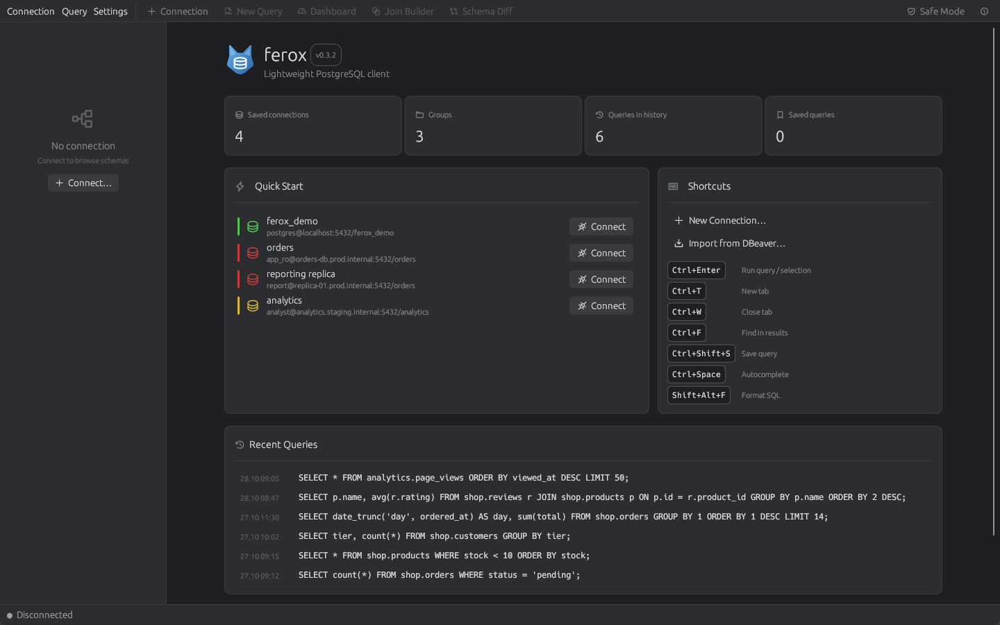
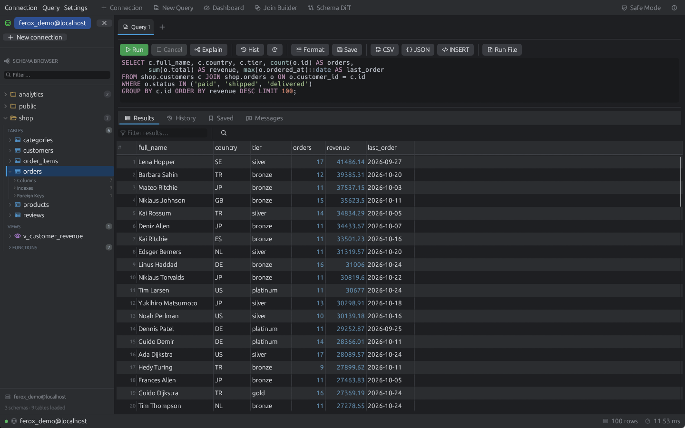
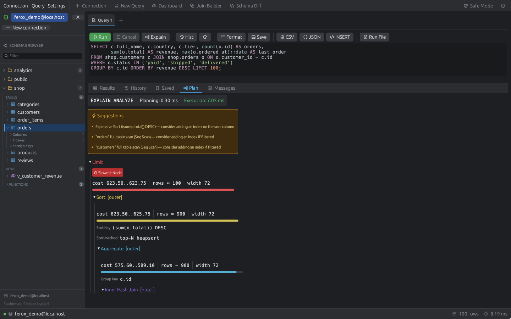
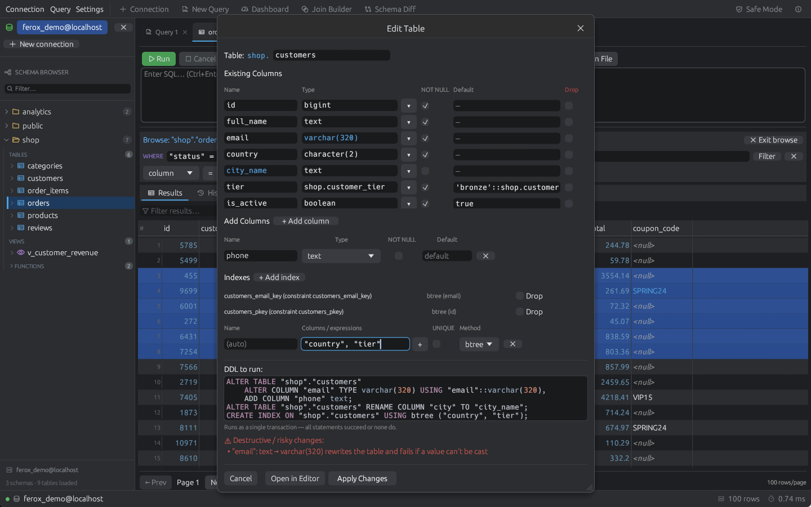
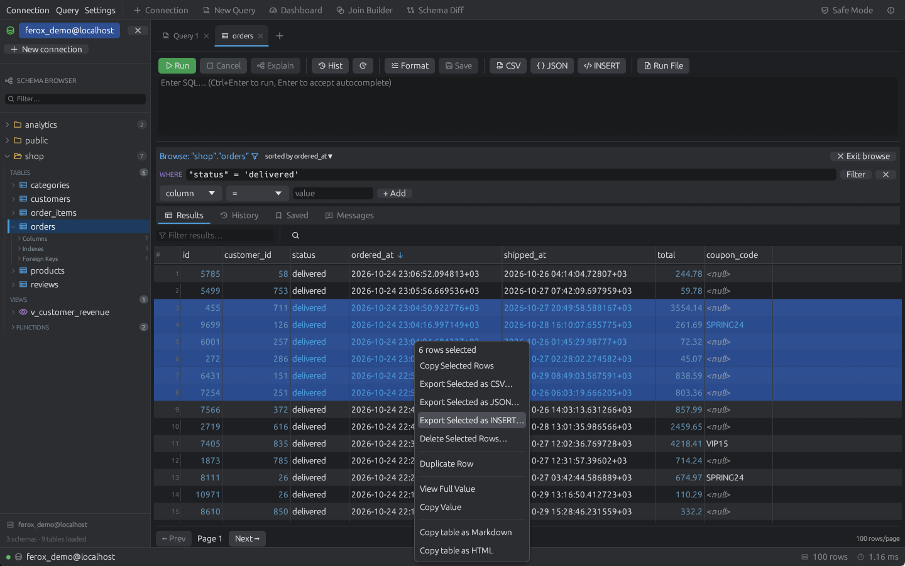
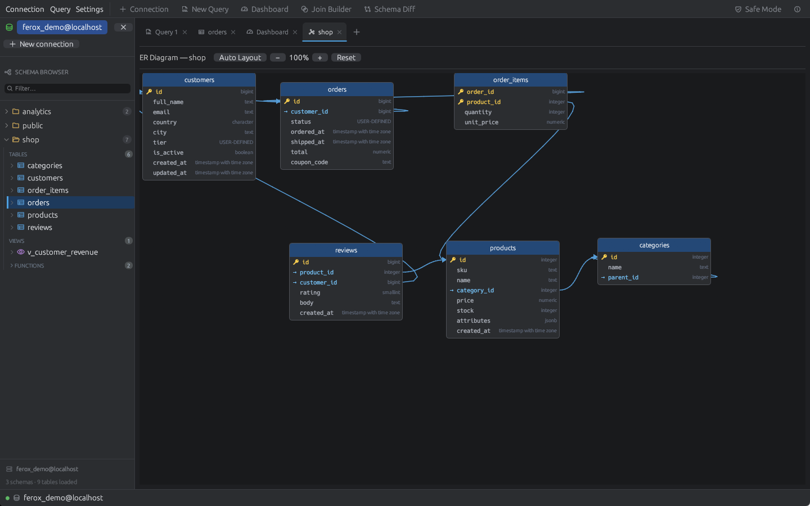
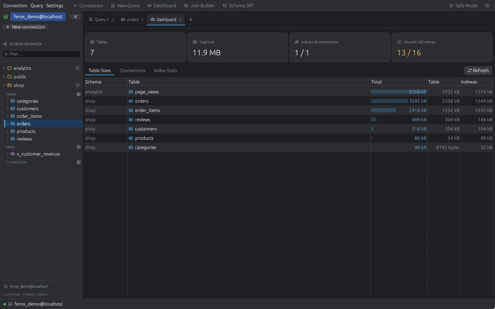
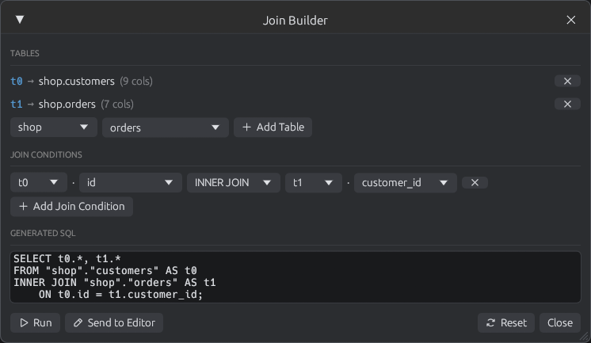

<div align="center">



```
███████╗███████╗██████╗  ██████╗ ██╗  ██╗
██╔════╝██╔════╝██╔══██╗██╔═══██╗╚██╗██╔╝
█████╗  █████╗  ██████╔╝██║   ██║ ╚███╔╝
██╔══╝  ██╔══╝  ██╔══██╗██║   ██║ ██╔██╗
██║     ███████╗██║  ██║╚██████╔╝██╔╝ ██╗
╚═╝     ╚══════╝╚═╝  ╚═╝ ╚═════╝ ╚═╝  ╚═╝
```

**A blazing-fast PostgreSQL client built in Rust.**
*No Electron. No JVM. No bloat.*

[](https://github.com/frkdrgt/ferox/actions)
[](https://github.com/frkdrgt/ferox/releases)
[](LICENSE)
[](https://www.rust-lang.org)

</div>

---

> **Ferox** is a native PostgreSQL client in a ~10 MB binary, idling at ~40–55 MB of RAM and starting in under 200 ms — because your database client shouldn't be the bottleneck.

---

## Screenshots

*All screenshots use a fictional demo database — recreate it with [`scripts/demo_db.py`](scripts/demo_db.py).*

<div align="center">



*Home screen — saved connections grouped by environment, shortcuts and recent queries*

</div>

| Query editor | EXPLAIN ANALYZE visualizer |
|:------------:|:--------------------------:|
|  |  |

| Table structure editor (DDL preview) | Browse mode — filter builder & bulk actions |
|:------------------------------------:|:-------------------------------------------:|
|  |  |

| ER diagram | Database dashboard |
|:----------:|:------------------:|
|  |  |

<div align="center">



*Join Builder — compose multi-table JOINs visually*

</div>

---

## Features

### ✨ AI — Natural Language to SQL, Explain, Optimize & Fix

Click the **✦ AI** button in the toolbar to open the NL bar. Type plain English — Ferox fetches the live schema from your DB and sends it to the AI, so the generated query always uses your real tables and columns.

```
"show me the top 10 customers by total order value in the last 30 days"
```

The **✦ ▾** menu next to it works on the query in the editor (or just the selection):

- **Explain query** — a plain-language walkthrough: what it returns, how tables are joined, and pitfalls (NULL handling, join fan-out, missing `LIMIT`)
- **Optimize query** — a faster rewrite with the same result; the AI also sees your **indexes**, and suggests a `CREATE INDEX` when that would help more
- **Fix error with AI** — after a query fails, sends the query plus the Postgres error and returns a minimal fix with the cause explained (also offered in the Messages tab)

AI-generated SQL is **never run automatically** — it opens in a review window. If a suggestion adds a write operation the original didn't have (`DELETE`, `DROP`, `UPDATE`, …), a red warning names it. *Replace in editor* saves your original query to history first.

**Supported providers** (configure via `Settings → AI`):

| Provider | Notes |
|----------|-------|
| **Anthropic Claude** | `claude-haiku-4-5` by default — fast and cheap |
| **Groq** | `llama-3.3-70b-versatile` — free tier available |
| **Ollama** | Fully local, no API key, no data leaves your machine |
| **OpenAI** | `gpt-4o-mini` by default |
| **Custom / OpenRouter** | Any OpenAI-compatible endpoint via base URL override |

---

### Core
- **Multi-tab query editor** — Ctrl+T new tab, Ctrl+W close, right-click for Close / Close Others / Close All
- **Run selection** — select part of the editor and F5 / Ctrl+Enter / Run / Explain execute only that
- **Per-table tabs** — clicking a table opens it in its own tab; existing tabs are reused
- **Schema browser** — lazy-loaded tree: schemas → tables / views / mat-views / foreign tables / functions / sequences / triggers, live filter
- **Data browser** — double-click any table or view to browse with server-side pagination & ORDER BY
- **Structured filter builder** — pick a column/operator/value (`=, !=, >, <, LIKE, ILIKE, IS NULL, IN`, …) in browse mode, or type a raw `WHERE` fragment directly
- **Multi-row selection & bulk actions** — Shift/Ctrl+Click to select rows, then bulk **copy / export as CSV, JSON or INSERT / delete** (confirmation dialog, PK-based)
- **Duplicate Row** — right-click a row to INSERT a copy, auto-omitting primary-key columns
- **Inline editing** — double-click a cell to edit, Enter to commit, Escape to cancel
- **JSON/JSONB pretty-print** — the cell value popup detects JSON, pretty-prints and syntax-highlights it, with a Pretty/Raw toggle
- **Persistent query history** — last 500 queries, searchable, click to reload
- **Saved queries** — Ctrl+Shift+S saves the editor under a name; searchable Saved tab

### Schema & Data Tools
- **Table structure editor** — rename columns, change types (automatic `USING` cast), set/drop `NOT NULL` and `DEFAULT`, add/drop columns, add/drop indexes (PK/UNIQUE-backed ones via `DROP CONSTRAINT`), rename the table. The exact DDL is always previewed, risky changes are flagged in red, and everything applies as **one transaction** — or open it in the editor instead
- **Schema dump** — right-click a schema → dump structure + data (or structure only) to a `.sql` file. No `pg_dump` needed, works through the SSH tunnel; consistent snapshot, rows streamed through a cursor (types, sequences, functions, partitions, constraints, indexes, views, matviews, triggers — not owners/grants/RLS/comments). PostgreSQL 12+
- **CSV import** — right-click a table → Import CSV…; columns are read from the file's header and streamed in via `COPY FROM STDIN`
- **Export** — CSV, JSON and **INSERT statements** via native OS file dialog; copy results as Markdown/HTML
- **View DDL** — right-click any view or materialized view → Show DDL
- **Script generation** — right-click table → Generate SELECT / INSERT / UPDATE / DELETE scripts
- **ER diagram** — visual schema relationship viewer with FK arrows, pan/zoom, draggable nodes
- **Schema diff** — compare the structure of two connections/schemas
- **Column statistics** — right-click any column header → null %, distinct count, min/max length, top values (computed on the database in browse mode)

### Query Tools
- **Multi-statement execution** — `;`-separated statements run in sequence; each SELECT result opens in its own tab
- **EXPLAIN visualizer** — tree view of query plans with cost, rows, and timing per node; slowest-node highlight and optimization suggestions
- **Safe mode transactions** — DML wrapped in explicit BEGIN/COMMIT/ROLLBACK
- **Join Builder** — visual multi-table JOIN composer (`Query → Join Builder…`)
- **SQL formatting** — Shift+Alt+F
- **Find in results** — Ctrl+F highlights matching cells

### Connections & Security
- **Connection profiles** — saved to `config.toml` (see [Configuration](#configuration)); SSL modes + SSH tunnel (password or private key)
- **Import from DBeaver** — `Connection → Import from DBeaver…` finds your DBeaver workspace and imports PostgreSQL connections with passwords, SSH, SSL mode, folders and prod/test color; duplicates are detected
- **Credentials in the OS keychain** — connection/SSH passwords and the AI API key are stored via Windows Credential Manager / macOS Keychain / Linux Secret Service, not as plain text
- **Connection color tags** — flag a connection red/yellow/green/blue (e.g. "Production") so it stands out on the tab bar and connection switcher
- **Multiple simultaneous connections** — per-connection sidebar, tabs, and DB threads
- **Auto-reconnect** — a dropped connection is re-established on the next command

### Developer Experience
- **SQL syntax highlighting** — zero-dependency tokenizer, dark (`base16-ocean.dark`) and light (`InspiredGitHub`) themes
- **SQL autocomplete** — table names (with alias suggestions), column names, keywords; Ctrl+Space to force
- **Database dashboard** — table sizes, index stats, active connections with kill support
- **Update check** — a banner tells you when a new release is out (one GitHub API request at startup on a background thread; nothing is downloaded automatically). Turn it off under `Settings → Check for updates on startup`
- **EN / TR localisation** — full bilingual UI; language choice persists to config

---

## Performance

| Metric | Ferox |
|--------|-------|
| RAM at idle | **~40–55 MB** (working set) |
| Cold startup | **< 200 ms** |
| Binary size | **~10.1 MB** |

*Measured on Windows 11, release build with LTO (v0.3.1). The binary grew from ~7 MB
after adding OS-keychain-backed credential storage (`keyring` crate) — its Windows backend
pulls in a full regex engine. RAM/startup are unaffected (keychain I/O only happens
on connect/save, never per-frame).*

---

## Installation

### Pre-built binaries

Download the latest release for your platform from the [Releases page](https://github.com/frkdrgt/ferox/releases).

| Platform | File | Format |
|----------|------|--------|
| Windows 10+ | `ferox-windows-x64.exe` | standalone `.exe` |
| macOS 12+ (Intel + Apple Silicon) | `ferox-macos-universal.dmg` | disk image containing `Ferox.app` |
| Linux x86\_64 | `ferox-linux-x64.tar.gz` | tarball containing the `ferox` binary |

### macOS — first launch

Open the `.dmg` and drag `Ferox.app` to Applications (or run it straight from the mounted volume). macOS may still block it with an "unidentified developer" warning because Ferox is not notarized — if so, clear the quarantine flag:

```bash
xattr -rd com.apple.quarantine /Applications/Ferox.app
```

Then double-click to launch.

### Linux — first launch

```bash
tar -xzf ferox-linux-x64.tar.gz
chmod +x ferox
./ferox
```

### Build from source

```bash
# Prerequisites: Rust 1.88+ (https://rustup.rs)
git clone https://github.com/frkdrgt/ferox.git
cd ferox
cargo build --release
```

Binary lands at `target/release/ferox` (or `ferox.exe` on Windows).

---

## Quick Start

1. Launch Ferox
2. **Connection → New Connection…** — enter host, port, user, password, database
3. Toggle SSL if needed (`prefer` works for most setups)
4. Hit **Connect** — schema tree loads on the left

### Running a query

Type SQL in the editor, press `F5` or `Ctrl+Enter`. Select part of the text first to run only that.

```sql
SELECT u.name, COUNT(o.id) AS orders
FROM users u
LEFT JOIN orders o ON u.id = o.user_id
GROUP BY u.name
ORDER BY orders DESC;
```

Or use the **Join Builder** (`Query → Join Builder…`) to construct joins visually.

### Keyboard shortcuts

| Shortcut | Action |
|----------|--------|
| `F5` / `Ctrl+Enter` | Run query (or the selection) |
| `Ctrl+C` | Cancel running query |
| `Ctrl+T` | New tab |
| `Ctrl+W` | Close tab |
| `Ctrl+Tab` / `Ctrl+Shift+Tab` | Next / previous tab |
| `Ctrl+Shift+S` | Save query |
| `Ctrl+Space` | Show autocomplete |
| `Ctrl+A` | Select all in the editor |
| `Shift+Alt+F` | Format SQL |
| `Ctrl+F` | Find in results |
| `F5` (sidebar focused) | Refresh schema tree |

---

## Configuration

Profiles are stored automatically (config file directory is still named `pgclient` — a holdover from before the `ferox` rebrand):

| Platform | Config file | Query history |
|----------|------|----------------|
| Windows | `%APPDATA%\pgclient\config.toml` | `%LOCALAPPDATA%\pgclient\history.txt` |
| macOS | `~/Library/Application Support/pgclient/config.toml` | `~/Library/Application Support/pgclient/history.txt` |
| Linux | `~/.config/pgclient/config.toml` | `~/.local/share/pgclient/history.txt` |

```toml
language = "en"          # "en" or "tr"
null_color = [128, 100, 100]
check_updates = true     # GitHub release check at startup
# skipped_version = "0.3.2"  # set by "Skip this version" in the update banner

[[connections]]
name     = "prod-readonly"
host     = "db.example.com"
port     = 5432
user     = "analyst"
database = "warehouse"
ssl      = "require"
color    = [200, 60, 60] # optional danger tag: red/yellow/green/blue, or omit
```

**Passwords aren't in this file if a keychain entry exists.** On first successful
save, ferox moves the connection password (and SSH tunnel password, and AI API key)
into Windows Credential Manager / macOS Keychain / Linux Secret Service, and clears
the plain-text field here. If no keychain backend is available, the password stays
in this file as a plain-text fallback — nothing breaks, you just don't get the
extra protection.

History keeps the last 500 entries.

---

## Architecture

Ferox uses three dedicated threads, zero shared mutable state between them:

```
┌──────────────────────────────────────────────────────────┐
│                  UI Thread (eframe)                      │
│   egui immediate-mode rendering                          │
│   sidebar · tabs · join builder · NL bar                 │
└────────┬───────────┬──────────────┬───────────┬──────────┘
         │ DbCommand │ DbEvent      │ AiCommand │ AiEvent
         ▼           ▼              ▼           ▼
┌────────────────────┐   ┌─────────────────────────────────┐
│   DB Thread        │   │        AI Thread (tokio)        │
│   (tokio)          │   │  reqwest · Anthropic / OpenAI   │
│   tokio-postgres   │   │  Groq · Ollama · custom         │
│   native-tls       │   │  Schema context fetched live    │
│   async queries    │   │  from DB before every request   │
└────────────────────┘   └─────────────────────────────────┘
```

All communication goes through `mpsc` channels — the UI thread never blocks.
The startup update check runs on a fourth, short-lived thread the same way.

---

## Tech Stack

| Role | Crate |
|------|-------|
| GUI framework | [`egui`](https://github.com/emilk/egui) + `eframe` |
| Table widget | `egui_extras` |
| PostgreSQL driver | [`tokio-postgres`](https://github.com/sfackler/rust-postgres) |
| Async runtime | `tokio` (current-thread per worker thread) |
| TLS | `native-tls` + `postgres-native-tls` |
| SSH tunnel | `russh` |
| AI HTTP client | `reqwest` (native-tls, JSON) |
| SQL highlighting | custom zero-dependency tokenizer (`src/ui/syntax.rs`) |
| Config | `serde` + `toml` |
| File dialogs | [`rfd`](https://github.com/PolyMeilex/rfd) |
| OS keychain | [`keyring`](https://github.com/open-source-cooperative/keyring-rs) |
| DBeaver credential import | `aes` + `cbc` (already linked via `russh`) |

---

## Roadmap

- [x] **Auto-complete** — table names, column names, SQL keywords
- [x] **Database dashboard** — table sizes, index bloat, active connections
- [x] **Multiple simultaneous connections** — separate DB threads per connection
- [x] **SSH tunnel** — connect through a jump host
- [x] **ER diagram** — visual schema relationships
- [x] **Multi-statement queries** — run multiple statements separated by `;`
- [x] **View DDL** — right-click any view or materialized view to see its definition
- [x] **Safe mode transactions** — explicit BEGIN/COMMIT/ROLLBACK for DML
- [x] **Join Builder** — visual multi-table JOIN composer
- [x] **EN/TR localisation** — full bilingual UI, language persists to config
- [x] **Settings & About** — Settings menu with language switcher and About dialog
- [x] **Test Connection** — verify credentials before connecting, from the connection dialog
- [x] **Close connection** — disconnect and remove a connection from the sidebar with one click
- [x] **Connection status indicators** — color-coded dots replacing broken emoji squares on Windows
- [x] **AI: Natural Language → SQL** — multi-provider (Claude, Groq, Ollama, OpenAI, custom), live schema context
- [x] **Ctrl+A** select-all in query editor
- [x] **Bookmarked queries** — saved queries/snippets, Ctrl+Shift+S, searchable panel
- [x] **Structured filter builder** — column/operator/value picker for browse-mode `WHERE` filters
- [x] **Multi-row selection & bulk actions** — bulk copy / export / delete, plus Duplicate Row
- [x] **CSV import** — via a file picker (`Import CSV…`), not drag-and-drop
- [x] **Connection color tags** — per-connection danger color, shown on tabs and the connection switcher
- [x] **Credentials in the OS keychain** — passwords and API keys no longer stored as plain text
- [x] **Run selection** — execute only the selected SQL
- [x] **AI: Explain / Optimize / Fix error** — with index-aware context and a review step before anything runs
- [x] **Table structure editor** — ALTER with live DDL preview, single transaction
- [x] **Schema dump** — `.sql` export of structure ± data without `pg_dump`
- [x] **Export as INSERT statements**
- [x] **Import connections from DBeaver**
- [x] **Update check** — GitHub releases banner
- [ ] **XLSX export**
- [ ] **Restore open tabs on restart**
- [ ] **Data compare** — diff table contents and generate sync SQL
- [ ] **Proxy settings** for DB and AI connections
- [ ] **Dark / light theme toggle** — runtime switch
- [ ] **Result diff** — compare two query results side-by-side

---

## Contributing

Bug reports, feature requests, and pull requests are welcome.

```bash
# Run against a local Postgres
docker run -d -p 5432:5432 -e POSTGRES_PASSWORD=test postgres:16

# Dev build (faster compile, debug symbols)
cargo build

# Unit tests — pure logic (SQL builders, tokenizers, quoting, parsers), no DB required
cargo test

# Integration tests — not run by default. They need a reachable local Postgres
# (CSV import, schema dump/restore round-trip, structure-editor DDL), the OS
# keychain, and network access (GitHub releases API). Point them at your instance
# with FEROX_TEST_PG_HOST/PORT/USER/PASSWORD/DATABASE (default: postgres/postgres
# @localhost:5432/postgres) if it differs.
cargo test -- --ignored

# Demo database used for the screenshots
pip install psycopg2-binary
FEROX_DEMO_DSN="host=localhost user=postgres password=test" python scripts/demo_db.py
```

Please keep the UI thread non-blocking and all DB work behind `DbCommand` / `DbEvent`.
See `CLAUDE.md` for architecture notes.

---

## How This Was Built

This project is an experiment in **vibe-coding** — writing software primarily through conversation with an AI, rather than typing code by hand.

Every line of Rust in this repository was generated by [Claude](https://claude.ai) (Anthropic) via [Claude Code](https://github.com/anthropics/claude-code). Every commit was authored through an AI session. The developer's role was to define what to build, review what came out, and decide what to do next — not to write the code itself.

### Why be upfront about this?

Because it matters. If you're evaluating this project — as a tool, as a reference, or as a hiring signal — you deserve to know how it was made. Passing this off as hand-crafted Rust would be dishonest.

### What the human actually did

- Chose the goal: a lightweight, native PostgreSQL client as an alternative to DBeaver/DataGrip
- Picked the stack: `egui`, `tokio-postgres`, `russh` — no Electron, no JVM
- Defined the architecture: two-thread model, `mpsc` channels, no shared mutable state between UI and DB
- Wrote the `CLAUDE.md` spec that guided every session
- Planned each feature phase, reviewed diffs, caught bugs, and made judgment calls
- Did *not* write the actual Rust

### What Claude actually did

- Wrote all source files from scratch (`src/app.rs`, `src/db/`, `src/ui/`, etc.)
- Made architectural decisions within the constraints given
- Debugged compile errors iteratively
- Kept the codebase consistent across sessions using the `CLAUDE.md` context

### Is the code good?

Honestly: mostly yes, sometimes no. The architecture is clean and the UI thread never blocks. There are places where a seasoned Rust developer would've made different tradeoffs — but it compiles, it runs, and it does what it's supposed to do. It started from zero and grew to a multi-feature desktop app across a handful of sessions.

### The point

This isn't about whether AI-generated code is "real" code. It's about what's now possible when you pair a clear technical vision with a capable AI. Ferox exists because it was cheap enough — in time and effort — to just build the thing.

Whether that's exciting or unsettling probably says something about where you are in your relationship with these tools.

---

## License

MIT — see [LICENSE](LICENSE)

---

<div align="center">

*Built with Rust because life's too short for slow database clients.*
*Written by Claude because that's just where we are now.*

</div>
